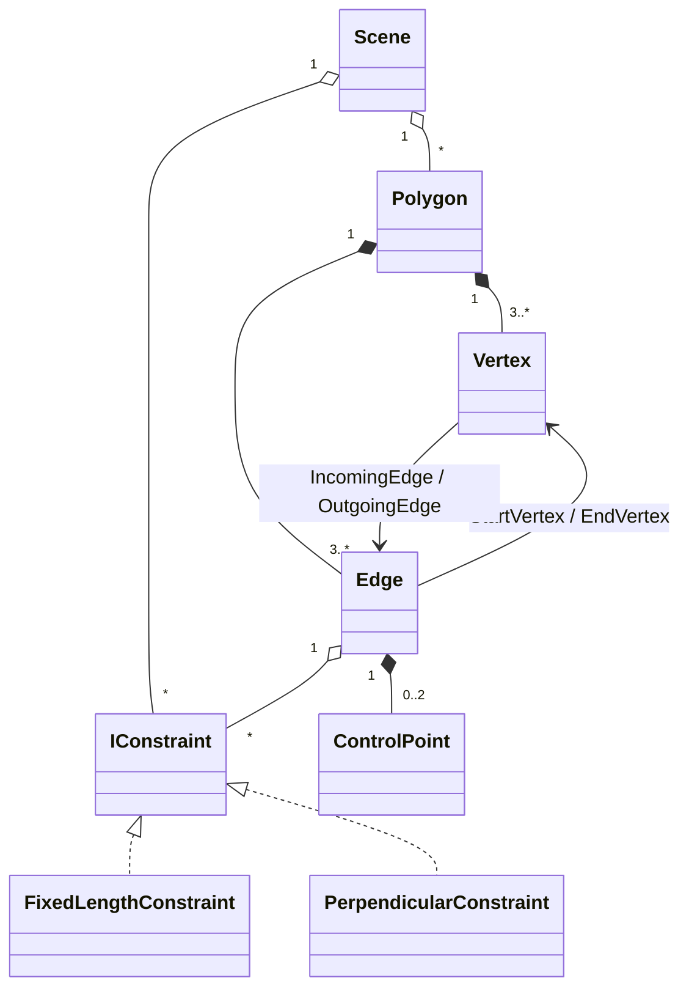

# Edytor wielokątów

Instrukcja obsługi, założenia i opis algorytmów są dostępne w aplikacji: menu **Pomoc** (lub klawisz **F1**).

## Model danych

Projekt jest podzielony na dwie warstwy:

- `PolygonEditor.Core` – model sceny, geometria i ograniczenia (bez zależności od WinForms),
- `PolygonEditor` – interfejs (WinForms), obsługa myszy i rysowanie.

### `Scene`
- `Polygons` – lista wielokątów; im dalej na liście, tym wyżej rysowany (i wcześniej trafiany przy wyszukiwaniu pod kursorem).
- `Constraints` – globalna lista wszystkich ograniczeń.
- Jedyny punkt modyfikacji złożonych: przesuwanie wierzchołków i punktów kontrolnych (wywołuje solver ograniczeń i przywracanie ciągłości), dodawanie/usuwanie ograniczeń, wierzchołków, zmiana typu krawędzi.
- Wyszukiwanie pod kursorem: `FindVertexAt`, `FindControlPointAt`, `FindEdgeAt`, `FindPolygonAt` (zwracają także wielokąt – rekordy `VertexHit`, `EdgeHit`).

### `Polygon`
- `Vertices`, `Edges` – listy cykliczne: `Edges[i]` łączy `Vertices[i]` z `Vertices[(i + 1) % Count]`.
- Minimum 3 wierzchołki (`MinVertexCount`).
- Operacje: `Translate`, `InsertVertexOnEdge`, `RemoveVertex`, `ContainsPoint` (reguła even-odd na konturze, w którym krzywe są przybliżone łamaną).

### `Vertex`
- `X`, `Y` – położenie (`float`).
- `IncomingEdge`, `OutgoingEdge` – sąsiednie krawędzie (lista dwukierunkowa wierzchołek ↔ krawędź).
- `ContinuityType` – `G0`, `G1` lub `C1`; `IsContinuityExplicitlySet` – czy ustawił ją użytkownik (wtedy nie jest nadpisywana domyślnym C1).
- `MoveWithControlPoints` – przesuwa wierzchołek razem z zaczepionymi przy nim punktami kontrolnymi.

### `Edge`
- `StartVertex`, `EndVertex`.
- `EdgeType` – `Line`, `Bezier` lub `Arc`.
- `ControlPoint1`, `ControlPoint2` – punkty kontrolne (tylko dla krzywej Béziera 3. stopnia, w pozostałych przypadkach `null`).
- `Constraints` – ograniczenia nałożone na krawędź (dodawane i usuwane wyłącznie przez `Scene`).
- Łuk nie przechowuje żadnych dodatkowych danych – jego geometria (`CircularArc`) jest wyliczana na bieżąco z końców i ciągłości w nich.

### `ControlPoint`
- `X`, `Y`, `ParentEdge` (krzywa, do której należy), `Anchor` (`Start`/`End`) → `AnchorVertex` – wierzchołek, przy którym leży.

### Ograniczenia – `IConstraint`
- `Edges` – krawędzie, których dotyczy; `Vertices` – wierzchołki, które może przesuwać.
- `IsSatisfied(epsilon)`, `Enforce(lockedVertices)` – sprawdzenie i wymuszenie bez ruszania zablokowanych wierzchołków.
- `IconLabel` – etykieta rysowana przy krawędzi.
- Implementacje: `FixedLengthConstraint` (zadana długość), `PerpendicularConstraint` (prostopadłość dwóch odcinków, także z różnych wielokątów).
- Ograniczenie jest zapisane jednocześnie w `Scene.Constraints` i w `Edge.Constraints` każdej swojej krawędzi – solver przechodzi graf ograniczeń przez wierzchołek → krawędzie → ograniczenia.

### Klasy pomocnicze (bez stanu)
- `ConstraintSolver` – przywracanie ograniczeń (BFS + relaksacja).
- `ContinuityEnforcer` – utrzymanie ciągłości G0/G1/C1 w wierzchołkach.
- `CubicBezier`, `CircularArc`, `GeometryMath` – geometria (wyliczanie punktów, stycznych, odległości).

### Warstwa UI
- `MainForm` – okno, pasek menu (Pomoc), wybór algorytmu rysowania odcinków.
- `InteractionController` – obsługa myszy, menu kontekstowe, stan przeciągania i oczekującej prostopadłości.
- `SceneRenderer` – rysowanie sceny (algorytm biblioteczny lub Bresenham na `DirectBitmap`).
